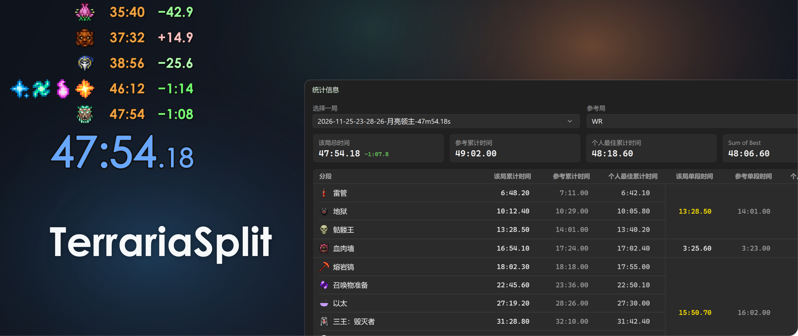

# TerrariaSplit

<p align="center">
  
</p>
<p align="center">
  <span>English</span> ·
  <a href="README.md">简体中文</a>
</p>

TerrariaSplit is a Windows split timer for Terraria. It is built around boss-route timing, and also supports item, NPC, biome, and other conditions. It provides a visual settings UI, real-time overlay, statistics, and automation tools for practice and world generation.

Supports Terraria `1.4.6.1`, while retaining ordinary timing and world-creation support for `1.4.5.8` and `1.4.4.9`.

## Version Support

| Feature | 1.4.4.9 | 1.4.5.8 | 1.4.6.1 |
|---|---|---|---|
| Core Split detection | Supported | Supported | Supported |
| Automatic world creation | Legacy delay-based flow | State-driven flow | State-driven flow |
| Seed-filtering baseline | 1.4.5.8 | 1.4.5.8 | 1.4.6.1 |
| Extended UI scaling | Unsupported | Supported | Supported |
| Race | Unsupported | Unsupported | Exact build match |

Ordinary features select implementations by the `1.4.4`, `1.4.5`, and `1.4.6+` version groups. Other versions in a group may run after the required structure checks pass. Race requires the registered `1.4.6.1` x86 build, matching both its version and build fingerprint.

## Core Features

### Timing And Routes

- Supports multiple condition types: boss defeats, item pickups, NPC arrivals, and biome entry.
- Supports multi-target conditions such as "all completed", "any completed", and "at least N completed".
- Supports custom groups, including main groups, attached groups, and their display conditions.

### Display

- Supports mouse passthrough and a compact RTSS OSD for fullscreen Terraria.
- Supports configuring the main UI font, icons, opacity, colors, shadows, and outlines.
- Supports icon lighting, current-stage highlighting, font color gradients, boss defeat animations, and segment highlight animations.

### Data And Statistics

- Records run data automatically and can optionally update personal bests.
- The statistics page can compare current results, historical results, personal bests, and reference times.

### Automation Tools

- Creates worlds with one action, including special and secret seeds, and loads practice saves.
- Supports pyramid filtering, item filtering, and Zenith auto star catch.

### Race

- Race lets multiple players use the same world, route, and reference times while seeing each other's progress and ranking in real time.
- When upgrading to `1.13.0.0`, update both the client and Race Server. Race no longer accepts older Terraria Race builds or older world files; existing ordinary routes and statistics are retained.
- Race requires a separately started Race Server. Use the following command to start it with a specific port:

Windows:

```powershell
.\TerrariaSplit.Race.Server.exe --urls http://0.0.0.0:5000
```

Linux:

```bash
./TerrariaSplit.Race.Server --urls http://0.0.0.0:5000
```

- Replace `5000` with the port you want. If players are not on the same LAN, the server must be reachable through a public IP address, port forwarding, or a tunneling service.


## Notes

- This project was primarily built with AI assistance.

## OBS Capture Black Background

If OBS window capture shows a black background, try using the Windows 10 capture method instead of the traditional window capture method.

## Acknowledgements

- Thanks to [LiveSplit](https://github.com/LiveSplit/LiveSplit) for inspiring the speedrun timer layout and split display style.
- Boss icon lighting and presentation were inspired by [kengho/terraria-boss-checklist](https://github.com/kengho/terraria-boss-checklist).

## License

This project is licensed under the MIT License.
