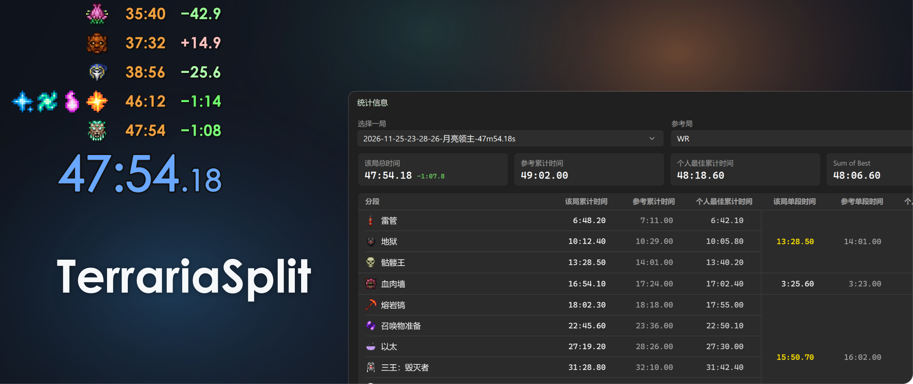

<div align="center">




<br>
<br>

<p>
  
  
  
</p>


</div>


**TerrariaSplit** 是一款专为 Terraria 打造的轻量级 Windows 透明分段计时器。进入世界自动起表、击败 Boss 或达成自定义目标自动分片，并内置统计对比、一键创图刷图与多人联机竞速模式，帮助你在单人冲榜、分段练习与好友对战中专注游戏本身。

## ✨ 功能亮点

- **🎯 自动分段与灵活路线**
  - 自动检测 **Boss 击败**、**物品获取**、**城镇 NPC 入住**与**生物群系进入**。
  - 支持“全部完成”“任意完成”“至少完成 N 个”等多目标组合，以及主分组、附属分组与自定义显示窗口。
  - 内置**练习模式**，支持直接点击界面修改任意分段时间或总时间。
- **🎨 高度可定制的透明浮层**
  - 无边框透明悬浮显示，支持一键**鼠标穿透**，以及通过 **RTSS** 在独占全屏 Terraria 中显示简洁 OSD。
  - 自由调整四列排版、字体、透明度、颜色、描边与阴影。
  - 内置 Boss 图标点亮、当前阶段聚焦、差值动态渐变、单段最佳高亮、Boss 击败过场动画与自定义音效。
- **📊 数据统计与个人最佳**
  - 自动保存每次运行记录，可选自动更新累计 PB 与单段最佳，并留存历史快照。
  - 统计面板支持随时对比当前记录、历史记录、个人最佳与参考时间。
- **⚡ 刷图与练习自动化**
  - 一键创建世界（支持彩蛋与秘密种子）、快捷加载练习存档、Zenith 世界自动接星。
  - 支持按金字塔、地牢侧猩红、雀杖/星怒箱与丛林深度/资源自动筛选种子，并可选后台世界池预热实现快速开图。
- **🏆 多人联机竞速**
  - 房主创建 4 位房号房间，一键同步同一份世界、路线与参考时间，实时查看全员进度、排名浮窗、游戏内菜单与语音播报。
  - 支持公平随机控制与 Boss 战失败罚时机制。

## 🚀 快速开始

1. 前往 [Releases](https://github.com/0x000005/TerrariaSplit/releases) 下载最新版本的客户端压缩包并解压到任意目录。
2. 运行 `TerrariaSplit.exe`，然后启动 Terraria。
3. 进入世界后计时器会自动开始计时；**右键点击计时器**即可打开 **设置 / 统计 / 竞速 / 切换配置**。

### 默认快捷键

| 快捷键 | 功能 |
|---|---|
| `F8` | 暂停 / 继续计时 |
| `F6` | 重置计时 |
| `F9` | 开关鼠标穿透 |

> 所有快捷键均可在 **设置 → 常规** 中自由修改。

## 🎮 游戏版本支持

| 功能 | 1.4.4.9 | 1.4.5.8 | 1.4.6.1 |
|---|---|---|---|
| 核心自动分片检测 | ✅ 支持 | ✅ 支持 | ✅ 支持 |
| 一键自动创图 | 旧版延时流程 | ✅ 状态驱动流程 | ✅ 状态驱动流程 |
| 种子自动筛选 | ✅ 支持 | ✅ 支持 | ✅ 支持 |
| 游戏界面缩放增强 | ❌ 不支持 | ✅ 支持 | ✅ 支持 |
| 多人联机竞速 | ❌ 不支持 | ❌ 不支持 | ✅ 仅支持官方 `1.4.6.1` |

## 🌐 架设联机竞速服务器

多人竞速需要单独运行 **TerrariaSplit Race Server**（支持 Windows / Linux）：

**Windows：**
```powershell
.\TerrariaSplit.Race.Server.exe --urls http://0.0.0.0:5000
```

**Linux：**
```bash
./TerrariaSplit.Race.Server --urls http://0.0.0.0:5000
```

- 将 `5000` 替换为你需要的端口号即可。若玩家不在同一局域网，服务器需具备公网 IP、端口转发或内网穿透。
- 升级至 `1.13.0.0+` 时，请将**客户端与竞速服务端一并更新**。

## ❓ 常见问题

<details>
<summary><strong>OBS 窗口捕获出现黑色背景怎么办？</strong></summary>

请将 OBS“窗口捕获”属性中的捕获方式改为 **Windows 10**，不要使用传统的 BitBlt 捕获方式。

</details>

<details>
<summary><strong>遇到刷图筛选或运行异常，如何导出诊断日志反馈？</strong></summary>

TerrariaSplit 默认在出错时自动保存 `terrariasplit.log`。反馈问题时，请按以下任一方式导出诊断包：

1. 右键计时器打开 **设置 → 高级 → 日志**，点击 **导出诊断信息** 导出 `.zip` 诊断包；
2. 在自动化失败弹窗中直接点击 **导出诊断信息**；
3. 如需记录更完整的日常过程日志，可在 **设置 → 高级 → 日志** 中将日志级别调整为 `INFO` 或 `DEBUG`。

如需调整 **Race Server** 的日志级别，可在启动前设置 `TERRARIA_SPLIT_LOG_LEVEL`（可选 `DEBUG` / `INFO` / `WARN` / `ERROR` / `NONE`）：

```powershell
$env:TERRARIA_SPLIT_LOG_LEVEL = 'INFO'
.\TerrariaSplit.Race.Server.exe --urls http://0.0.0.0:5000
```

</details>

## 🙏 致谢与说明

- 本项目主要使用 AI 辅助构建。
- 感谢 [LiveSplit](https://github.com/LiveSplit/LiveSplit) 对速通计时器布局和分段展示方式的启发。
- 感谢 [kengho/terraria-boss-checklist](https://github.com/kengho/terraria-boss-checklist) 对 Boss 图标点亮与呈现方式的启发。

<sub>开发者与贡献者可参阅 <a href="docs/ARCHITECTURE.md">ARCHITECTURE.md</a> 与 <a href="docs/DESIGN.md">DESIGN.md</a>。</sub>

## 📄 License

本项目采用 [MIT License](LICENSE) 开源许可。
