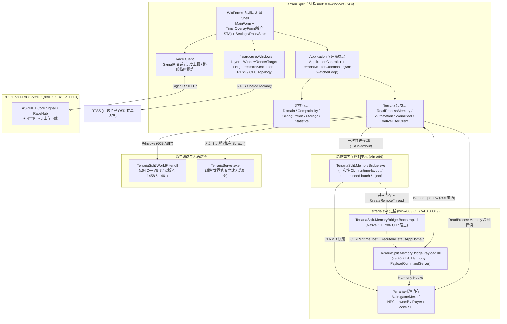
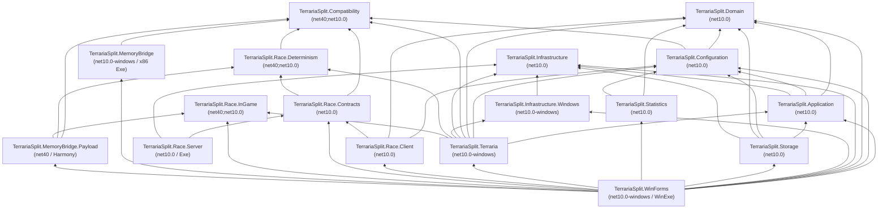
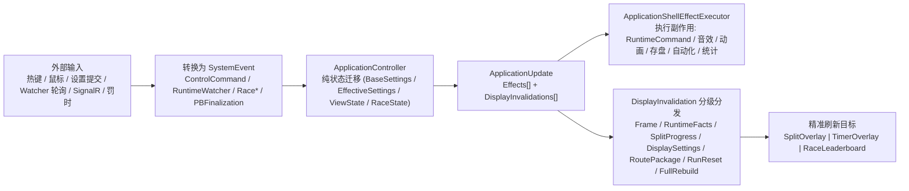
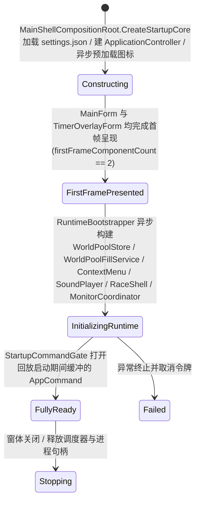

# TerrariaSplit 系统架构文档

> 适用版本：`1.13.0.0+` · 文档职责：描述 **TerrariaSplit** 的宏观系统拓扑、模块依赖边界、并发与数据流模型，以及各核心子系统的工程实现细节。  
> 产品语义、视觉规范与交互规则见 [DESIGN.md](DESIGN.md)；日常开发与构建纪律见 [AGENTS.md](../AGENTS.md)；原生种子筛选 DLL 契约见相邻仓库 `../../TerrariaResourceJudge/docs/ABI.md`。

---

## 1. 系统全景与运行拓扑

TerrariaSplit 是一款运行于 Windows 平台的 `.NET 10`（x64）桌面应用程序。由于目标游戏 `Terraria.exe` 是 **32 位（x86）`.NET Framework 4.0`（CLR `v4.0.30319`）** 进程，而高性能种子预筛需要接近原生的 C++ 吞吐，且联机竞速需要跨网络状态同步，整个系统采用 **多进程 + 跨位数桥接 + 原生引擎协同** 的运行拓扑：



### 运行时角色分工

| 进程 / 组件 | 位数与框架 | 生命周期 | 核心职责 |
|---|---|---|---|
| `TerrariaSplit.exe` | x64 / `net10.0-windows` | 常驻 | 组合根、双窗 Overlay 渲染、计时状态机、自动化编排、直接读游戏内存、调用筛选 DLL、连接竞速服务端。 |
| `TerrariaSplit.MemoryBridge.exe` | x86 / `net10.0-windows`（单文件自包含） | 一次性短进程 | 解决 x64 主程序无法直接通过 CLRMD 探测/注入 32 位 Terraria CLR 的位数约束；不驻留、不持有业务状态。 |
| `MemoryBridge.Bootstrap.dll` | x86 / Native C++ | 注入后拉起 CLR 即卸载 | 在 `Terraria.exe` 内读取共享内存指令，宿主 `v4.0.30319` CLR 并调用 `EntryPoint.Initialize`，随后自卸载。 |
| `MemoryBridge.Payload.dll` | AnyCPU / `net40` | 竞速期间驻留游戏内 | 挂载 Harmony Hook（世界锁、确定性 RNG、Boss 罚时、游戏内竞速菜单），运行 NamedPipe 命令服务与 20 秒租约看门狗。 |
| `TerrariaSplit.WorldFilter.dll` | x64 / Native C++（GCC 严格 Release） | 进程内按需加载 | 外部 `TerrariaResourceJudge` 构建产物；执行 ABI7 双版本（1458/1461）原生种子筛选与早拒判定。 |
| `TerrariaServer.exe` | 游戏自带 | 后台按需启停 | 供 `HeadlessWorldGenerator` 在私有临时目录中无头生成 `.wld`，服务于后台世界池与竞速开房创图。 |
| `TerrariaSplit.Race.Server` | x64 / `net10.0`（Win/Linux） | 独立部署服务 | SignalR 房间状态机、进度/死亡/完成广播、`.wld` 校验与分发、战绩落盘与过期房间清理。 |

---

## 2. 解决方案分层与 18 项目依赖规则

解决方案 [TerrariaSplit.slnx](../TerrariaSplit.slnx) 包含 **17 个生产项目 + 1 个自定义测试宿主**（另含独立的 `test/TerrariaSplit.Diagnostics.csproj` 与原生 `src/TerrariaSplit.MemoryBridge.Bootstrap`）：



### 模块职责与隔离边界

| 层级 | 项目 | TFM | 关键职责与红线 |
|---|---|---|---|
| **核心纯层** | `Domain` | `net10.0` | 计时器、分段状态机、条件树、事实快照、物品/NPC/群系目录；**零外部依赖、零 IO/UI/调度**。 |
| **共享兼容** | `Compatibility` | `net40;net10.0` | 版本组、能力路由表、精确竞速指纹、筛选器版本指纹；**跨框架共享、零平台副作用**。 |
| **共享竞速** | `Race.Determinism` | `net40;net10.0` | HMAC-SHA256 确定性随机源、无偏概率抽取与整数累加器；同时服务于服务端与 `net40` Payload。 |
| **共享竞速** | `Race.InGame` | `net40;net10.0` | 游戏内竞速菜单二进制快照/动作协议（v4）与 Boss 罚时表编解码；不依赖 WinForms。 |
| **配置层** | `Configuration` | `net10.0` | `AppSettings` Schema、内嵌默认 JSON、深克隆、归一化、路线分组/覆盖包、世界池签名、中英本地化。 |
| **基础设施** | `Infrastructure` | `net10.0` | 基于 `Microsoft.Extensions.Logging` 的四级结构化日志（`AppLog` / `AppLogProvider` / `RollingLogWriter` / `AppFault` / ZIP 诊断导出）、原子文件读写 `JsonFileStore`、`OperationResult`、数据路径抽象。 |
| **Windows 设施** | `Infrastructure.Windows` | `net10.0-windows` | `LayeredWindowRenderTarget`、`HighPrecisionScheduler`、`RtssOsdWriter`、`ProcessCpuTopology`、Win32 P/Invoke。 |
| **应用编排** | `Application` | `net10.0` | `AppCommand`/`SystemEvent`/`ApplicationEffect` 编排、`TerrariaMonitorCoordinator`、`RunFinalizer`；**只表达意图，不执行副作用**。 |
| **持久与统计** | `Storage` / `Statistics` | `net10.0` | 配置多档案持久化、参考/PB/历史记录存储、`WorldPoolStore`、统计对比表构建；不持有计时状态机。 |
| **游戏集成** | `Terraria` | `net10.0-windows` | 内存直读、UI 缩放补丁、菜单/存档/世界池自动化、原生 ABI7 筛选客户端、竞速世界锁服务；不依赖 WinForms。 |
| **联机协议栈** | `Race.Contracts` / `Client` / `Server` | `net10.0` | 联机 DTO 与 `.wld` 校验、SignalR 客户端会话与重连、ASP.NET Core 竞速服务端；客户端不依赖 UI。 |
| **内存控制** | `MemoryBridge` / `Bootstrap` / `Payload` | `x86` / C++ / `net40` | 统一承载 32 位 CLRMD 探测、种子预测与进程内 Harmony 注入；线协议源码通过链接共享。 |
| **表现组合根** | `WinForms` | `net10.0-windows` | `MainShellCompositionRoot`、双窗 Overlay、渲染管线、10 页懒加载设置、竞速与统计窗体、热键、语音、自动更新。 |

---

## 3. 核心运行模型：单向数据流、线程拓扑与启动生命周期

### 3.1 Command–Event–Effect–Snapshot 单向管线

所有状态变更收敛于 `ApplicationController.HandleSystemEvent(SystemEvent)`：



- **双层配置状态**：`ApplicationController` 同时维护 `BaseSettings`（用户持久化设置）和 `Settings`（叠加了竞速房间 `SettingsRouteOverridePackage` 后的生效设置）。离开竞速房间执行 `ClearRouteOverrideCommand` 即可无损恢复本地路线。
- **序列号防乱序**：每次从 UI 提交 `RuntimeCommand` 都会分配单调递增序列号（`RuntimeCommandSequencer`），`ApplicationController` 记录 `MinimumAcceptedRuntimeCommandSequence`，自动丢弃早于最新重置或路线切换的过期 `WatcherPollNotification`。

### 3.2 线程与调度拓扑

| 线程 / 调度器 | 归属 | 周期 / 触发方式 | 职责与线程安全机制 |
|---|---|---|---|
| **UI 主线程（STA）** | `MainForm` | Win32 消息循环 | 持有 `ApplicationController`、`MainForm`（Split 状态层）、统计/竞速窗体、全局热键消息；所有业务决策串行化在此线程执行。 |
| **设置窗口线程（STA）** | `SettingsDialogHost`（`TerrariaSplit Settings UI`） | 独立消息循环 | 独立承载 `SettingsForm` 避免阻塞主界面，应用设置、窗口关闭与更新重启回调统一派发回 UI 主线程执行。 |
| **独立计时窗口线程（STA）** | `TimerOverlayWindowHost` | 独立消息循环 + 内部高帧率调度 | 专职渲染底部 `TimerOverlayForm`，接收不可变 `TimerOverlayRenderState` 与布局坐标，与主 UI 线程完全解耦。 |
| **Watcher 后台线程** | `WatcherLoop`（`TaskCreationOptions.LongRunning`） | 自适应间隔：未附着 `1s` / 扫描 `250ms` / 就绪 `5ms` | 消费 `RuntimeCommand`，轮询 `TerrariaWorldWatcher.Poll()`，在 `WatcherRuntimeProcessor` 内推进 `SplitTimer` 与 `SplitTracker`，仅在状态变化或 `250ms` 心跳时发布不可变 `RuntimeRunSnapshot`。 |
| **UI 控制调度器** | `HighPrecisionScheduler`（`TerrariaSplit UI control`） | 未就绪 `5ms`；就绪后按 `ReadyUiControlHz`（默认 `100Hz` / `10ms`） | 驱动 `MonitorCoordinator.Tick`（调度 UI 缩放补丁检查等），通过 `Interlocked.Exchange` 合并未消费派发防止消息队列积压。 |
| **状态层绘制调度器** | `HighPrecisionScheduler`（`TerrariaSplit status paint`） | 可配刷新率（`RefreshRateSettings`） | 触发状态层增量重绘（动画、高亮、图标帧动画）；静止无变化时直接跳过渲染。 |
| **RTSS 推送调度器** | `HighPrecisionScheduler`（`TerrariaSplit RTSS overlay`） | 动态节流（变化即写 + `1s` 保活） | 格式化并向 RTSS 共享内存推送全屏 OSD 文本与样式。 |
| **后台世界池任务** | `WorldPoolFillService` | `Task.Run` 常驻循环（满池后 `8s` 休眠） | 批量并发预筛种子（单世界 1 线程）并串行调用 `TerrariaServer.exe` 生成入池。 |
| **竞速网络与锁任务** | `RaceClientSession` / `TerrariaRaceWorldLockService` | 异步 I/O 线程池 | SignalR 长连接收发、HTTP 上传/下载 `.wld`、NamedPipe 轮询游戏内竞速菜单与租约续期。 |

**UI 响应优先机制**：`WatcherCompletionDispatcher` 每次向 UI 线程批处理最多 8 条完成通知，并在每次派发前检查 `UiInputMessageProbe.HasPendingInputMessage`——若检测到待处理鼠标/键盘消息则主动让位，保证高轮询频率下交互零卡顿。

### 3.3 两阶段冷启动生命周期

为最小化“双击到看到透明计时器”的冷启动延迟，[StartupLifecycle.cs](../src/TerrariaSplit.WinForms/UI/StartupLifecycle.cs) 将启动严格分为两阶段：



- 在 `FullyReady` 前触发的命令（如热键）不会丢失或空引用，而是进入 `StartupCommandGate` 排队，待运行期服务挂接完成后按 FIFO 顺序回放。
- 环境变量 `TERRARIA_SPLIT_STARTUP_TRACE_PATH` 与命名事件可用于自动化冷启动耗时基准测试（`StartupDiagnostics`）。

---

## 4. 领域核心与配置兼容层（`Domain` / `Compatibility` / `Configuration`）

### 4.1 `Domain`：纯计时与三值逻辑状态机
- **`SplitTimer`**：记录 `Phase`（`NotStarted` / `Running` / `Paused`）、`ElapsedBeforePause` 与 `RunningSinceTimestamp`（`Stopwatch.GetTimestamp()`），支持竞速 `AddElapsedPenalty(TimeSpan)` 与练习模式 `SetPracticeElapsed`，并提供值类型 `SplitTimerState` 供跨线程零拷贝快照。
- **`SplitCondition` & `TerrariaGameFacts`**：
  - `TerrariaGameFacts` 是大小写不敏感的不可变事实字典（`FactValue` 支持 `Unknown` / `Boolean` / `Integer`），构造时预计算排序 `StatusHash` 用于快速相等比较。
  - `SplitCondition` 支持递归树（`All` / `Any` / `AtLeast` / `Fact`）及 `IsTrue` / `IsFalse` / `AtLeast` / `Equal` 比较，返回三值结果 `SplitConditionResult`（`Unknown` / `False` / `True`），避免内存尚未就绪时把“未知”误判为“未完成”或“已完成”。
- **`SplitTracker`**：
  - 每次 `Update` 前自动从物品持有数派生 `item:<id>:ever-owned` 历史最大值事实，确保消耗/丢弃关键物品后条件不回退；
  - 开局 `OnRunStarted` 将所有分段置为 `initialStateResolved = false`，首帧若发现某段已满足则直接标为 `Skipped`（防旧档误分片），仅当明确观测到 `IsKnownIncomplete` 后才进入可触发状态；
  - 区分主分段与附属分段（`IsAttached`）：附属分段仅在前置主分段全部完成/跳过后开放，且跳过主分段会自动跳过中间未完成的段落。

### 4.2 `Compatibility`：版本组路由与竞速精确指纹
- **`TerrariaFeatureCatalog`** 将全部能力分为 4 大类（`WorldCreation` / `Race` / `SplitDetection` / `UiScale`）并按版本组（`1.4.4` / `1.4.5` / `1.4.6+`）路由实现：
  - 普通能力（Split 检测、创图、筛选、UI 缩放）对已验证版本返回 `Supported`，对同组未登记小版本返回 `AllowedToTry`（由各模块执行运行时结构/签名校验后尝试运行）；
  - 筛选器映射：`1.4.4` / `1.4.5` → `ResourceJudge1458`（生成指纹 `d5f79871...`），`1.4.6+` → `ResourceJudge1461`（生成指纹 `dd2ea7e3...`），详见 [TerrariaResourceJudgeBuilds.cs](../src/TerrariaSplit.Compatibility/TerrariaResourceJudgeBuilds.cs)；
  - **竞速能力硬门禁**：必须同时匹配 [TerrariaBuilds.cs](../src/TerrariaSplit.Compatibility/TerrariaBuilds.cs) 登记的版本号 `1.4.6.1`、x86 架构、存档版本 `329` 以及 `Terraria.exe` PE 模块的精确 `ModuleVersionId`（`316ae3ed-ed52-4207-a7cf-8c70fc902a47`）。

### 4.3 `Configuration`：强归一化与隔离签名
- **`AppSettings`** 划分为 9 个强类型子节（`General`、`Hotkeys`、`Route`、`Comparison`、`Overlay`、`Automation`、`Race`、`PracticeWorlds`、`Advanced`），默认值来自内嵌资源 `settings.default.json` 与 `reference-splits.default.json`。
- 所有加载、编辑、保存路径都必须经过 `AppSettingsCloner` 深拷贝 + `SettingsNormalizer` / `SettingsSectionNormalizer` 归一化，避免 UI 与后台共享可变对象引用。
- **`WorldPoolSignature`** 将实际游戏版本、ResourceJudge 生成指纹、世界尺寸、邪恶类型、难度、特殊/秘密种子及全部有效筛选条件编码为隔离键，任一参数变动都会使旧世界池自动失效重建。

---

## 5. 应用编排层（`Application`）

- **`TerrariaMonitorCoordinator`**：
  - 统一包装 `WatcherLoop`、`RuntimeCommandSequencer`、`WatcherRuntimeProcessor`、`WatcherCompletionDispatcher` 与 `UiScalePatchScheduler`；
  - 当收到 `SetDefinitions` 命令时，同步通过 `RuntimeObservedFactKeys.FromDefinitions` 计算当前路线最小事实集合并下发给 `ITerrariaWorldWatcher.SetObservedFactKeys`，减少无谓内存读取；
  - `WatcherRuntimeProcessor.CaptureSnapshot` 对比实时 `SplitTimerState` 与 `SplitTracker` 每项状态，未变化时直接复用上一帧 `RuntimeRunSnapshot` 引用，使 `ShouldPublishWatcherCompletion` 能以零分配 `ReferenceEquals` 快速短路。
- **`TimerController` & `PendingMenuActionScheduler`**：
  - 检测 `TerrariaWatchSnapshot.EnteredWorld` 自动启动计时器；当所有主分段完成时自动停表并发出 `RunCompleted`；
  - 支持在游戏内菜单动作（重置、一键创图、练习世界）排队并附带 `0.5s` 宽限期，避免刚退回主菜单时误触发或漏触发。
- **`RunFinalizer`**：
  - 在 Run 完成或重置时评估累计 PB（全部已启用主分段完成且无跳过，以最后一个主分段的累计时间比较现有 PB，不限定 Boss）和单段最佳（连续无跳过主分组刷新），生成不可变 `PersonalBestFinalizationPlan`；
  - 采用两阶段提交：先发 `FinalizePersonalBestEffect` 由外层持久化与确认，再通过 `PersonalBestFinalizationSystemEvent` 携带 `PlanId` 回传结果；若期间 `BaseSettings` 已被其他操作修改则安全拒绝覆写并提示。
- **`UiScalePatchScheduler`**：
  - 按 `2s` 重试间隔在后台线程池执行 `ITerrariaUiScalePatchApplier.TryApply()`，按 PID 记忆已打补丁的进程并监测进程存活，避免重复扫描内存。

---

## 6. 内存读取与跨位数控制单元（`Terraria.Memory` / `MemoryBridge` / `Bootstrap` / `Payload`）

### 6.1 为什么必须拆分 x86 `MemoryBridge`
主程序为 x64 以获得大内存筛选与现代运行库优势，但官方 Windows 版 `Terraria.exe` 为 32 位 `.NET Framework 4.0`。CLRMD（`Microsoft.Diagnostics.Runtime`）读取托管堆/静态字段以及 `CreateRemoteThread(LoadLibraryW)` 注入原生 DLL 均要求**控制进程与目标进程同位数**，因此项目抽出单一 `win-x86` 可执行程序 `TerrariaSplit.MemoryBridge.exe` 集中承载所有跨位数操作。线协议定义于 [MemoryBridgeProtocol.cs](../src/TerrariaSplit.MemoryBridge/Protocol/MemoryBridgeProtocol.cs)，由消费方直接源码链接共享。

### 6.2 只读监控链路（普通模式 & 竞速共用）
1. **一次性布局探测**：附着到 `Terraria.exe` 后，`TerrariaClrMemoryResolver` 调用 `TerrariaSplit.MemoryBridge.exe runtime-layout <pid>`。
2. **CLRMD 快照解析**：`MemoryBridge` 调用 `DataTarget.CreateSnapshotAndAttach(pid)`，在单次快照中解析 9 组布局与进程启动时间 `ProcessStartTimeUtcTicks`：
   - `Core`（`Main.gameMenu`、`statusText`、`MenuUI`）、`Boss`（17 个 `NPC.downed*` 及 `Main.hardMode` 静态地址）、`Item`（本地玩家装备/背包/4 组银行/鼠标与垃圾桶偏移）、`Npc`（城镇 NPC 数组与入住偏移）、`Biome`（`Player.zone1~zone5` 偏移）、`SeedUi`（创图界面种子文本扫描布局）、`WorldGeneration`（进度与当前 Pass 名称）、`MenuAutomation`（1.4.5+/1.4.6+ 菜单 UI 静态地址、字段偏移、类型指针及键盘位偏移）与 `Startup`（`showSplash` / `EngineLoaded`）。
3. **高频无侵入直读**：`TerrariaRuntimeLayoutCache` 缓存布局，后续每 `5ms` 轮询完全在 x64 主进程内由 `ProcessMemoryReader`（`ReadProcessMemory`）按 `TerrariaFactReadPlan` 按需读取，不再启动 `MemoryBridge`；若 `Main.gameMenu` 地址失效或进程重启则自动重置并重新探测。
4. **种子序列预测**：前台创图预筛可调用 `MemoryBridge random-seed-batch <pid> <count>`，从 UI 线程的 `[ThreadStatic] Terraria.Main.rand` 读取 `UnifiedRandom` 内部状态，预测接下来 1~256 个随机种子。

### 6.3 进程内注入控制链路（仅联机竞速模式）

```mermaid
sequenceDiagram
    participant Lock as TerrariaRaceWorldLockService (x64)
    participant MB as MemoryBridge.exe inject (x86)
    participant BS as Bootstrap.dll (Native x86 in Terraria)
    participant PL as Payload.dll (net40 in Terraria)

    Lock->>MB: 启动 inject <pid> <Bootstrap.dll> "start\n<base64 pipe>\n<hostPid>"
    MB->>MB: 创建命名共享内存 Command/Result + Completed 事件
    MB->>BS: VirtualAllocEx + WriteProcessMemory + CreateRemoteThread(LoadLibraryW)
    BS->>BS: DllMain 起工作线程 -> 读取 Command 共享内存
    BS->>PL: CLRCreateInstance(v4.0.30319) -> ExecuteInDefaultAppDomain(EntryPoint.Initialize)
    PL->>PL: TerrariaHookAudit1461 校验版本/MVID + 安装 Harmony Hooks
    PL->>PL: 启动 PayloadCommandServer (NamedPipe + 20s 租约看门狗)
    PL-->>BS: 返回初始化码 (0=成功)
    BS->>MB: 写入 Result 共享内存 + SetEvent(Completed) -> FreeLibraryAndExitThread
    MB-->>Lock: 退出码 0
    loop 竞速全生命周期
        Lock<->PL: NamedPipe Base64 命令帧 (lock / create-player / start-race / menu-exchange / boss-penalty / status / unlock)
    end
```

- **安全与自清理**：`PayloadCommandServer` 内置 20 秒租约看门狗（`WatchLease`），若主程序意外崩溃超过 20 秒未续租，Payload 自动执行 `shutdown` 解除锁定并关闭管道，避免游戏陷入死锁状态。
- **`Payload` 内部核心模块**：
  - `EntryPoint.cs` / `RaceStart.cs` / `RaceRestart.cs` / `RacePlayerProvisioning.cs`：锁定世界列表与存档路径、程序化创建竞速人物、7 秒同步倒计时与自动进图/重开；
  - `AdvancedDeterminismHooks.cs` & `RaceRuntimeRuleHooks.cs`：接管掉落、炼金、幸运、世界事件、星尘/城镇与世纪之花花苞计划（`TerrariaPlanteraBulbPlan`），使用 `Race.Determinism` 派生一致随机序列；
  - `RaceBossPenaltyHooks.cs`：监听 8 个目标 Boss 的脱战事件并按剩余血量计算罚时上报（玩家死亡仅记录现场与候选遭遇状态，不直接结算；玩家未死亡时 Boss 脱战同样触发结算）；
  - `RaceInGameMenu.cs`：Hook Terraria 菜单 UI 渲染竞速大厅/配置页面，将用户交互回传给外部 `RaceShell`。

### 6.4 界面缩放增强补丁（`TerrariaUiScalePatch`）
独立于 `MemoryBridge`，由主程序按 `TerrariaFeature.UiScale`（支持 `1.4.5` 与 `1.4.6+` 两组独立 IL 字节特征）扫描 `Terraria.exe` 主模块内存，将鼠标滑块显示/赋值范围与手柄滑块上限的浮点常量由 `2.0f`（200%）原地改写为 `3.0f`（300%）。

---

## 7. 游戏自动化、原生种子筛选与世界池（`Terraria.Automation` / `Terraria.WorldGeneration`）

### 7.1 双代菜单自动化与一键创图流程
- **双代菜单适配**：`TerrariaMenuProfile` 按运行中游戏版本选择菜单驱动：
  - `1.4.4.9` 沿用固定延时与几何坐标点击（`LegacyMenu`）；
  - `1.4.5.8` / `1.4.6.1` 使用 `ModernMenuAutomation`，通过 `MemoryBridge` 解析的 `MenuAutomationLayoutDto` 实时观测 `Main.menuMode`、`MenuUI._currentState` 及按钮真实矩形坐标，实现状态驱动点击与文本输入。
- **`CreateWorldWorkflow` 执行顺序（关键不变式）**：
  1. 激活窗口并配置现代菜单观测；
  2. **先执行存档准备**：将非收藏存档移至备份目录（或 `PreserveExistingSaves` 模式下仅采集清点快照）——**必须在世界池安装与建人之前执行**，避免误删刚安装的池中世界；
  3. 计算 `WorldPoolSignature` 并尝试 `WorldPoolInstallWorkflow.TryInstall`（若池中有匹配世界，拷贝至 Terraria `Worlds/` 目录，创建人物并停在选图界面，随后只删除私有池条目）；
  4. 若池空或未启用世界池，走 `WorldCreationMenuDriver`（若启用筛选则经 `PyramidSeedPreScreenLoop` 调用原生评估器选出合格种子）创建世界，并在 Zenith 彩蛋配置下衔接 `ZenithStarCatchAutomation` 自动接星。
- **文本输入与辅助隔离**：现代菜单下的人物名、世界名与种子通过 Unicode 键盘输入并回读内存确认；人物外观模板粘贴与旧版菜单（`1.4.4.9`）文本输入经 `ClipboardBackupScope` 无损备份恢复剪贴板；所有步骤包装于 `AutomationRunner`，支持随时取消与结构化故障报告。

### 7.2 原生 ABI7 种子筛选与线程预算
- **托管评估与尺寸换算（`WorldSeedFilterEvaluator`）**：
  - 仅提取完整复制种子中最后一个 `|` 之后的数字种子提交分析（不限制特殊/秘密种子选择，实际创图保留完整串）；随机邪恶在每个候选评估前先解析为具体猩红或腐化；
  - 将设置中存储的小世界基准档位换算为中/大世界实际格数后填充 60 字节 ABI7 请求结构（偏移 56 写入 `1458` 或 `1461`），DLL 不做二次缩放；
  - 连续 3 次候选模拟异常（超时/错误，不含普通未命中）即中止筛选并输出诊断；缺失或不兼容原生组件采取 **fail-closed** 策略。
- **并发与物理核预算（`JungleSeedJudgeNativeClient` + `WorldFilterThreadPolicy` + `ProcessCpuTopology`）**：
  - `ProcessCpuTopology` 调用 Windows CPU Sets API 统计当前进程亲和性与处理器组内的去重物理核心数；
  - 单世界自动线程数：$\max(1, \min(6, \lfloor 3 \times \text{availablePhysicalCores} / 4 \rfloor))$；多候选并发（后台世界池、竞速筛选）每世界固定 `1` 线程；
  - 托管层通过 `SingleWorldGate`、`BudgetReservationGate` 与全局 `NativeCallGate`（总量上限 `80%` 逻辑处理器数）严格串行预留预算，并将**实际预留线程数**直接传入 DLL；
  - **超时晚释放（`native.late-release`）**：单次调用默认 5 秒超时，超时后立即向调用方抛错，但线程预算租约挂在 `nativeCall.ContinueWith` 上，直到原生调用真正返回才释放，防止僵尸并发压垮 CPU。
- **托管模拟器定位**：`Terraria/WorldGeneration/Simulation/` 中的 C# 复刻实现仅服务于诊断工具与历史回归测试；生产筛选路径统一调用原生 ABI7 DLL。

### 7.3 后台世界池流水线（`WorldPoolFillService`）
- 发现本机 `TerrariaServer.exe`（`TerrariaServerLocator`）且启用世界池、池内余量低于 `WorldPoolTargetCount` 时运行；
- **批筛 + 串行建图**：每批并发评估 `ceil(logicalProcessorCount / 5)`（至少 1）个候选种子（每世界 1 线程），命中种子入队后由 `HeadlessWorldGenerator` 持跨进程互斥锁 `Local\TerrariaSplit.WorldPool.HeadlessWorldGenerator`，在私有 `WorldPoolScratchDirectory` 中驱动 `TerrariaServer.exe` 串行生成，校验文件稳定及头元数据后拷贝入 `WorldPoolStore`；
- 设置或版本指纹变更时立即清空待生成队列并重置 `WorldPoolStore` 签名，确保过期世界永不入池。

---

## 8. 联机竞速架构（`Race.*` + `RaceShell`）

### 8.1 服务端架构（`TerrariaSplit.Race.Server`）
- **通信面**：
  - SignalR Hub `/raceHub`（`RaceHub`，最大单消息 `8 MB`，挂载 `RaceHubLoggingFilter` 统一包裹调用 `OperationId` 与异常上下文）：处理 `CreateRoom`、`JoinRoom`、`ResumeRoom`、`UpdatePreparationStatus`、`SetPlayerReady`、`StartRace`、`RestartRace`、`ReportStart`、`ReportSplit`、`ReportDeath`、`ResetProgress`、`KickPlayer`、`LeaveRoom`、`CloseRoom`；
  - HTTP 端点 `/api/race/rooms/{roomCode}/world`（最大请求体 `128 MB`，外层中间件按请求建立 `AppLog.BeginOperation`）：`POST` 接收房主 multipart 上传（`.wld` + `worldSettings` + `route` + `seed` + 幂等 `operationId`），由 `RaceWorldUploadCoordinator` 与 `RaceWorldFileValidator` 校验世界文件版本（329）与 SHA-256 后落盘 `RaceWorldFileStore` 并广播 `RacePackageChanged`；`GET` 鉴权后流式下发 `.wld`。
  - 服务端日志接入同一 `AppLogProvider`，写入 `terrariasplit-race-server.log` 并同步输出至控制台，启动前通过 `TERRARIA_SPLIT_LOG_LEVEL` 控制落盘级别。
- **房间状态管理**：`RaceRoomManager` 维护最多 `10,000` 个 4 位数字房号房间（`Lobby` → `WorldUploaded` → `Ready` → `Starting(7s)` → `Running` → `Closed`），按房间锁保证状态一致性；`RaceRoomCleanupService` 后台清理过期房间与临时世界文件；`FileRaceRecordStore` 持久化战绩。

### 8.2 客户端会话与总控闭环（`Race.Client` + `RaceShell`）
- **`RaceClientSession`**：封装 SignalR 连接（带 `RaceReconnectRetryPolicy` 自动重连、重连后自动 `ResumeRoom` 与昵称重入恢复）、带指数退避（1s/2s/8s）的 HTTP `.wld` 上传，以及单次流式 HTTP `.wld` 下载（校验文件长度与 SHA-256，失败时清理临时文件）。
- **`RaceProgressTransport`**：将本地 `ApplicationController` 产生的开跑与分片事件按包版本 `PackageRevision` 与 `RunId` 顺序可靠上报，避免乱序或跨局污染。
- **`RaceShell`**（拆分为核心调度、`RaceShell.InGame.*`、`RaceShell.OwnerThread.cs`）：作为 WinForms 侧竞速总控，串联以下 5 条链路：
  1. 房主通过 `TerrariaRaceWorldGenerationService`（原生并发筛选 + 无头 `TerrariaServer.exe`）生成或选择 `.wld` 并上传；
  2. 收到 `RacePackageChanged` 后，通过 `RaceRouteOverrideController` 临时覆盖主计时器路线与参考时间，并将 `.wld` 同步到 `RaceWorldFileWorkspace`；
  3. 驱动 `TerrariaRaceWorldLockService` 注入并配置游戏内世界锁、确定性熵种子、世纪之花花苞计划、Boss 罚时表与人物创建；
  4. 持续与 `Payload` 交换 `RaceInGameSnapshot` / `RaceInGameAction`，双向同步游戏内竞速菜单与桌面 `RaceForm`；
  5. 接收全房进度与死亡事件，更新透明排行榜 `RaceLeaderboardForm`、向游戏内发送播报消息，并经 `RaceSpeechCoordinator`（`System.Speech`）触发语音播报。

---

## 9. WinForms 表现层、双窗渲染引擎与基础设施（`WinForms` / `Infrastructure.Windows`）

### 9.1 组合根与薄 Shell 拆分
[MainShellCompositionRoot.cs](../src/TerrariaSplit.WinForms/UI/MainShellCompositionRoot.cs) 集中装配所有服务与回调，[MainForm](../src/TerrariaSplit.WinForms/UI/MainForm.cs) 拆分为 `MainForm.cs`、`Startup`、`Runtime`、`Overlay`、`Rendering`、`Windowing` 6 个局部文件，并将各类副作用委托给专职 Shell：

| Shell / Coordinator | 职责 |
|---|---|
| `OverlayShell` | 管理双窗布局上下文、调色板缓存、静态脏标记、局部裁剪框与 `OverlayAnimationController`。 |
| `RuntimeShell` | 托管 `TerrariaMonitorCoordinator`、`ControlScheduler`、`StatusPaintScheduler` 及引用计数的暂停绘制机制。 |
| `WindowLayerController` + `ProgramModalWindowCoordinator` | 跨线程统一管理 `MainForm`、`TimerOverlayForm` 与所有模态弹窗的 Z-Order、`AlwaysOnTop`、Owner 链及输入拦截重定向。 |
| `HotkeyShell` + `GlobalHotkeyManager` | 注册/释放系统级热键、映射为 `AppCommand` 并在冲突时弹窗提示（设置页打开期间自动挂起）。 |
| `AutomationShell` | 串行调度 `CreateWorldWorkflow`、`EnterWorldWorkflow` 与 `PracticeWorldSelectorForm`，管理取消令牌。 |
| `SettingsShell` + `SettingsDialogHost` | 管理 `SettingsForm` 打开、热键挂起、应用回调与更新重启交接。 |
| `RaceShell` | 管理整个竞速模式生命周期（见第 8.2 节）。 |

### 9.2 双透明分层窗口与高性能渲染管线
- **为什么要拆分为两个窗口**：Split 分段列表（`MainForm`）大部分时间静止，仅在状态变化、Boss 动画或图标帧动时重绘；而底部主计时器（`TimerOverlayForm`）需要 60~144Hz 持续刷新毫秒数字。将后者放到独立 STA 线程 `TimerOverlayThread` 后，高频计时绘制与主线程 UI 弹窗、设置交互、列表重绘彻底零互相阻塞。
- **逻辑复合布局**：`OverlayCompositeLayoutCalculator` 根据缩放比例、保留行数（至少为动画预留 7 行）、字号及描边/阴影溢血（bleed）计算单一 `CompositeBounds`，切分为 `StatusScreenBounds` 与 `TimerScreenBounds`；任一窗口拖拽或边缘缩放均由 `OverlayBoundsController` 同步联动并持久化窗口坐标。
- **DIBSection + 脏矩形局部提交**：[LayeredWindowRenderTarget](../src/TerrariaSplit.Infrastructure.Windows/Infrastructure/LayeredWindowRenderTarget.cs) 维护持久化 32-bit ARGB `DIBSection` 与非托管 `UPDATELAYEREDWINDOWINFO` 缓冲，支持全帧 `Render` 与局部裁剪 `RenderRegion`（通过 `UpdateLayeredWindowIndirect` 仅向 DWM 提交 `dirtyRect`），实现无锯齿像素级 Alpha 透明，并支持 `WS_EX_LAYERED | WS_EX_TRANSPARENT` 鼠标穿透。
- **纯绘制渲染层（`UI/Rendering/`）**：严格遵循无副作用原则——`OverlayFrameBuilder` 构建不可变帧模型，`SplitListRenderer` / `TimerRenderer` / `SplitCompletionAnimationRenderer` 绘制内容，`TextEffectRenderer` 对描边/阴影采用 3 倍超采样（`SupersampleScale = 3`）离屏合成再回贴，`OverlayRenderResources` 与 `BossIconCache` 集中持有并复用 GDI+ 字体与位图资源。
- **RTSS 全屏 OSD 与高精度调度**：
  - `RtssOverlayPublisher` 在检测到 `Terraria.exe` 运行时按需拉起 RTSS，通过 `RtssOsdWriter` 写入共享内存实现全屏游戏内 OSD；
  - `HighPrecisionScheduler` 组合 `timeBeginPeriod(1)`、Windows 高分辨率 `WaitableTimer`（`0.1ms` 保护窗）与最后 `1ms` 自旋等待，保证高帧率计时与轮询的低抖动精度。

### 9.3 管理窗口体系（Settings / Statistics / Race）
- **10 页懒加载设置架构**：`SettingsForm` 通过 `SettingsPageHost` 注册 10 个页面（`General`、`Splits`、`Data`、`Ui`、`Effects`、`Automation`、`Sounds`、`Colors`、`Advanced`、`About`）；页面仅在首次选中时构建，跨页联动通过 `SettingsModelChange` / `ISettingsModelListener` 解耦，保存时按依赖顺序逐页 `Apply` 并穿插 `SettingsNormalizer.Normalize`。
- **Base-200 统一 DPI 缩放**：[UiDpiScale](../src/TerrariaSplit.WinForms/UI/UiDpiScale.cs) 以 `192 DPI`（200%）为设计基准，初始化时关闭 WinForms 自动缩放，按 `Clamp(DpiX / 192f, 0.5f, 2.5f)` 递归缩放窗口及整棵控件树并记录缩放状态，消除跨 DPI 屏幕错位。

---

## 10. 数据持久化与统计（`Storage` / `Statistics`）

- **用户数据与产物严格隔离**（通过 `IRuntimeDataPaths` / `AppContextRuntimeDataPaths` 注入，不写入 `src/` 或发布源）：
  - `Settings/`：用户配置文件（默认 `settings.json` 及自定义多配置）、`active-profile.txt` 记忆当前配置；
  - `Data/`：拆分存储的参考时间集、累计 PB 快照集、单段最佳快照集、历史运行记录（`SplitTimeSetRepository` / `RunStatsRepository`）；
  - `Worlds/`（及世界池子目录）：练习存档、世界池索引 `world-pool.json` 与预生成 `.wld`、私有 `scratch/` 临时目录；
  - `terrariasplit.log`（客户端）与 `terrariasplit-race-server.log`（服务端）：UTF-8 JSON Lines 滚动日志（程序目录不可写时自动回退至 `%LOCALAPPDATA%\TerrariaSplit`）。
- **持久化可靠性**：`JsonFileStore` 统一处理序列化与安全读写；`AppSettingsRepository` 启动时会验证候选配置文件合法性并在损坏时回退默认配置；保存失败一律通过 `OperationResult` 回传应用层并弹窗提示，不静默吞错。
- **统计聚合**：`StatisticsTableBuilder` 将当前路线配置、选定参考时间集、选定运行记录及累计/单段 PB 投影为不可变 `StatisticsTableRow` 列表供 `StatisticsForm` 展示。

---

## 11. 构建、打包、自动更新与可观测性

### 11.1 统一构建与原生组件编排
- **集中 Artifacts 布局**：[Directory.Build.props](../Directory.Build.props) 启用 `UseArtifactsOutput=true`（输出统一落在 `.build/{bin,obj,publish}/`），并将 `TerrariaSplitProductVersion` 作为全解决方案唯一版本真源。
- **MSBuild 扩展目标（`src/TerrariaSplit.WinForms/Build/`）**：
  - [MemoryBridge.targets](../src/TerrariaSplit.WinForms/Build/MemoryBridge.targets)：增量调用 `build-native.ps1` 编译 C++ x86 `Bootstrap.dll`，构建/发布时输出根目录单文件 `TerrariaSplit.MemoryBridge.exe` 并将 `Payload.dll`、`0Harmony.dll`、3 个 `net40` 共享库、`terraria-compatibility.json` 及 `Bootstrap.dll` 归集至 `Runtime/MemoryBridge/`（日常快速开发可用 `-p:TerrariaSplitSkipMemoryBridge=true` 跳过）；
  - [WorldFilter.targets](../src/TerrariaSplit.WinForms/Build/WorldFilter.targets)：从 `../TerrariaResourceJudge/out/resourcejudge-release/current/TerrariaSplit.WorldFilter.dll` 复制 ABI7 DLL（Release 模式强制存在）；
  - `ReleaseLayout.targets`：规范最终目录结构。

### 11.2 多产物发布与自动更新
- **统一发布脚本**：[eng/Publish-Release.ps1](../eng/Publish-Release.ps1) 校验版本号单调递增并回写 `Directory.Build.props`，分别发布：
  - `publish/TerrariaSplit-v<版本>-win-x64/`（附带 `Runtime/terrariasplit-update-manifest.json`）；
  - `publish/TerrariaSplit.Race.Server-v<版本>-win-x64/`；
  - `publish/TerrariaSplit.Race.Server-v<版本>-linux-x64/`；
  全流程仅产出可运行目录，不自动压缩，并核验二进制版本与 SHA-256。
- **GitHub 自动更新（`ApplicationUpdate`）**：查询 `0x000005/TerrariaSplit` 最新正式版 Release（严格校验 `vX.Y.Z.W` 标签与 `<= 512 MB` 包大小），下载并校验 SHA-256，解压到暂存目录后经 `Program.cs` 的 `ApplicationUpdateCommandLine.TryRun` 执行自替换并重启。

### 11.3 统一日志、错误回溯与诊断导出（`AppLog`）

- **分层边界**：全项目共享 `Microsoft.Extensions.Logging`（`ILogger` / `ILoggerFactory`）；`Infrastructure` 承载文件写入、近期缓冲、轮转与诊断打包，`Domain` 零日志依赖，`Race.Client` 仅接收 `ILoggerFactory`；`MemoryBridge` 与 `Payload` 沿用自身 stdout/NamedPipe 协议，由控制进程统一落盘。
- **日志级别与配置来源**：
  - 所有输入级别（含第三方 `Trace`/`Critical`）归一化为 `DEBUG` / `INFO` / `WARN` / `ERROR`，另有 `NONE` 完全关闭采集与输出；
  - 客户端默认落盘级别为 `ERROR`，在 **设置 → 高级 → 日志** 中持久化配置；启动早期可通过环境变量 `TERRARIA_SPLIT_LOG_LEVEL`（`DEBUG|INFO|WARN|ERROR|NONE`）覆盖，设置加载后以用户配置为准；
  - 服务端无设置界面，直接由 `TERRARIA_SPLIT_LOG_LEVEL` 控制落盘级别。
- **近期缓冲与错误触发回溯（`AppLogProvider`）**：
  - 非 `NONE` 模式下，全部四个级别事件均进入内存环形缓冲（上限 `60s` / `8 MiB`）；
  - 发生 `ERROR` 时，自动将缓冲内低于当前落盘阈值的近期记录按单调 `sequence` 去重回填至磁盘，并在错误条目上附加操作参数 `operationParameters`、已注册依赖指纹 `dependencies`（如 ResourceJudge SHA-256 与 ABI）及缓冲淘汰计数 `historyEvicted`；
  - 异步写队列上限 `16 MiB`，过载时优先丢弃低级别待写记录并输出 `logging.queue.truncated`。
- **JSON Lines 存储与轮转（`RollingLogWriter`）**：
  - 客户端写入程序目录 `terrariasplit.log`，服务端写入 `terrariasplit-race-server.log` 并同步输出控制台，格式为 UTF-8 JSON Lines（`schemaVersion = 1`）；
  - 保留当前活动文件与 4 份编号归档，单文件目标上限 `10 MiB`（单条超大记录保持完整不拆行）；遇到旧格式活动日志时先轮转归档再按新格式写入；
  - 程序目录不可写时回退至 `%LOCALAPPDATA%\TerrariaSplit`；多实例并发时自动附加 `.<pid>.<guid8>.log` 后缀隔离写入。
- **关联标识、故障模型与诊断打包**：
  - 每进程生成 `sessionId`，业务流程通过 `AppLog.BeginOperation` / `BeginStep`（`AsyncLocal`）传播 `operationId`、`operation` 与 `stage`，时间线还原以 `sessionId + sequence` 为准；
  - `AppFault` 封装 `ErrorId`、`Code`、`Operation`、`OperationId`、`Stage`、`Message`、`Diagnostic`、`Exception` 与 `LogPath`，统一支撑落盘记录、UI 可复制报错弹窗、未捕获异常汇入以及自动更新器 `update-error.json`；
  - Release 托管程序集启用 `DebugType=embedded` 与 `PathMap=/_/TerrariaSplit/`，无需额外分发 `.pdb` 即可在堆栈中保留源码位置；
  - **导出诊断信息**（`DiagnosticExportDialog` → `AppLogProvider.ExportAsync`）原子生成 `.zip` 诊断包，内含 `diagnostics.json`（环境、构建、依赖指纹、故障与日志路径）、`recent.jsonl` 及全部当前与轮转日志文件。

---

## 12. 测试与诊断体系（`test/`）

- **自定义确定性测试宿主（`test/TerrariaSplit.Tests.csproj`）**：
  - 入口 `test/Suites/Program.cs`（WinForms 路径通过 `StaTestHost` 在 STA 线程运行），按完整行为链组织 17 个测试套件（`CoreAndRun`、`ApplicationFlow`、`ConfigurationStorageFlow`、`CompatibilityFlow`、`Terraria1461Compatibility`、`ResourceJudgeVersion`、`MenuButtonMemory`、`ModernMenu`、`ClipboardAutomation`、`RaceFlow`、`RaceWorldUploadFlow`、`UpdateFlow`、`InfrastructureFlow`、`LoggingFlow`、`WindowsFlow`、`TerrariaIntegration`、`QualityGate`）；
  - 依赖真实原生 `TerrariaSplit.WorldFilter.dll` 与本机 Terraria 的高成本用例隔离在 `Native` 套件（需显式设置 `TERRARIA_SPLIT_TEST_SUITE=Native` 运行，缺少依赖时直接报失败）；
  - 支持 `$env:TERRARIA_SPLIT_TEST_FILTER` 按关键字聚焦运行。
- **独立诊断与基准工具（`test/TerrariaSplit.Diagnostics.csproj`）**：提供启动指标（`StartupMetrics`）、筛选配额/压力测试（`FilterQuotaMetrics`、`WorldFilterStress`）、运行时内存布局探针（`RuntimeLayoutProbe`）与历史金字塔/丛林深度分析命令，输出隔离在 `test/Results/` 与 `test/Temp/`。
