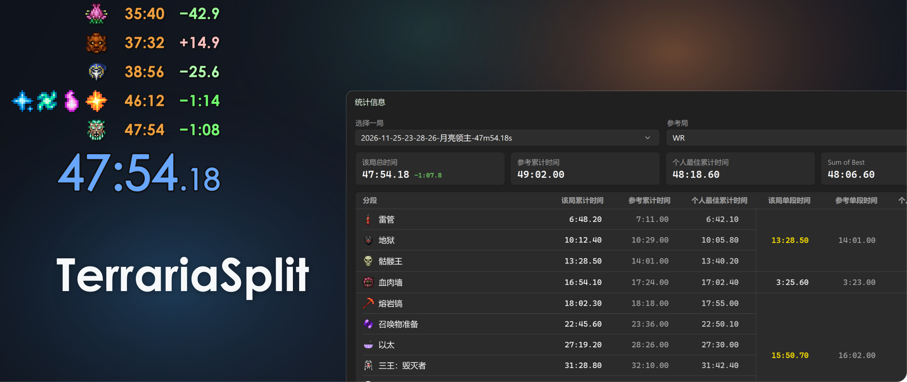

<div align="center">




<br>
<br>

<p>
  
  
  
</p>


</div>


**TerrariaSplit** is a lightweight, transparent Windows split timer built for Terraria. It starts automatically when you enter a world, splits on boss kills or custom objectives, tracks statistics and personal bests, automates world creation and seed filtering, and powers synchronized multiplayer races.

## ✨ Highlights

- **🎯 Automatic Splitting & Custom Routes**
  - Detects **boss defeats**, **item pickups**, **town NPC arrivals**, and **biome entry** automatically.
  - Supports multi-target logic ("all", "any", "at least N"), main & attached groups, and customizable visible row windows.
  - Includes **Practice Mode** so you can click directly on any split or total time to edit it.
- **🎨 Customizable Transparent Overlay**
  - Borderless transparent floating overlay with one-key **mouse click-through**, plus compact **RTSS OSD** support for fullscreen Terraria.
  - Customize columns, fonts, opacity, colors, outlines, and shadows.
  - Features boss icon lighting, current-stage focus highlight, delta color gradients, segment-best highlights, boss defeat animations, and custom sound effects.
- **📊 Run Statistics & Personal Bests**
  - Automatically logs run history and optionally updates cumulative PB and best segments with saved snapshots.
  - Compare recent runs, history, personal bests, and reference times side by side.
- **⚡ Practice & World-Rolling Automation**
  - One-click world creation (including special & secret seeds), quick practice save loading, and Zenith auto star catch.
  - Filter seeds by pyramids, dungeon-side Crimson, Finch Staff / Starfury chests, and jungle depth/resources, with an optional background world pool for instant starts.
- **🏆 Multiplayer Race Mode**
  - Host a 4-digit room sharing the same world, route, and reference times with live progress tracking, a floating leaderboard, an in-game Race menu, and optional voice announcements.
  - Supports fair RNG control and configurable boss failure time penalties.

## 🚀 Quick Start

1. Download the latest client release from [Releases](https://github.com/0x000005/TerrariaSplit/releases) and extract it anywhere.
2. Launch `TerrariaSplit.exe`, then start Terraria.
3. Entering a world starts the timer automatically. **Right-click the overlay** to open **Settings**, **Statistics**, **Race**, or switch configuration profiles.

### Default Hotkeys

| Hotkey | Action |
|---|---|
| `F8` | Pause / Resume |
| `F6` | Reset |
| `F9` | Toggle Mouse Click-Through |

> All hotkeys can be customized in **Settings → General**.

## 🎮 Terraria Version Support

| Feature | 1.4.4.9 | 1.4.5.8 | 1.4.6.1 |
|---|---|---|---|
| Core automatic splitting | ✅ Supported | ✅ Supported | ✅ Supported |
| One-click world creation | Legacy delay-based | ✅ State-driven | ✅ State-driven |
| Automatic seed filtering | ✅ Supported | ✅ Supported | ✅ Supported |
| Extended UI scaling | ❌ Unsupported | ✅ Supported | ✅ Supported |
| Multiplayer Race | ❌ Unsupported | ❌ Unsupported | ✅ Official `1.4.6.1` only |

## 🌐 Hosting a Race Server

Multiplayer Race requires a standalone **TerrariaSplit Race Server** (Windows / Linux):

**Windows:**
```powershell
.\TerrariaSplit.Race.Server.exe --urls http://0.0.0.0:5000
```

**Linux:**
```bash
./TerrariaSplit.Race.Server --urls http://0.0.0.0:5000
```

- Replace `5000` with your preferred port. For players outside your LAN, make sure the port is reachable via a public IP, port forwarding, or a tunnel.
- When upgrading to `1.13.0.0+`, update **both the client and Race Server together**.

## ❓ FAQ

<details>
<summary><strong>Why does OBS Window Capture show a black background?</strong></summary>

In your OBS Window Capture source properties, switch the capture method to **Windows 10** instead of the legacy BitBlt capture method.

</details>

<details>
<summary><strong>How do I export diagnostic logs when reporting an issue?</strong></summary>

By default, TerrariaSplit automatically writes `terrariasplit.log` whenever an error occurs. To share diagnostics:

1. Right-click the overlay, open **Settings → Advanced → Logging**, and click **Export diagnostics** to save a `.zip` bundle;
2. Or click **Export diagnostics** directly inside an automation failure dialog;
3. To capture more detail continuously, change **Minimum log level** in **Settings → Advanced → Logging** to `INFO` or `DEBUG`.

To configure the **Race Server** log level before launch, set `TERRARIA_SPLIT_LOG_LEVEL` (`DEBUG` / `INFO` / `WARN` / `ERROR` / `NONE`):

```powershell
$env:TERRARIA_SPLIT_LOG_LEVEL = 'INFO'
.\TerrariaSplit.Race.Server.exe --urls http://0.0.0.0:5000
```

</details>

## 🙏 Acknowledgements & Notes

- This project was primarily built with AI assistance.
- Thanks to [LiveSplit](https://github.com/LiveSplit/LiveSplit) for inspiring the speedrun timer layout and split display style.
- Thanks to [kengho/terraria-boss-checklist](https://github.com/kengho/terraria-boss-checklist) for inspiring boss icon lighting and presentation.

<sub>For developers and contributors, see <a href="ARCHITECTURE.md">ARCHITECTURE.md</a> and <a href="DESIGN.md">DESIGN.md</a> (Chinese).</sub>

## 📄 License

This project is licensed under the [MIT License](../LICENSE).
